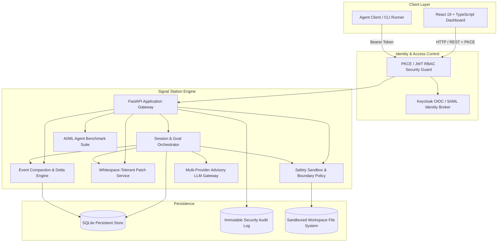

# Signal Station | Ryan Vo | AI & Machine Learning

> Work in progress. This checkpoint may be incomplete or fail tests. See PLAN.md and STATUS.md before use.


Current version: `1.0.0`.

Signal Station addresses the critical reliability and safety vulnerabilities of autonomous coding agents, specifically mitigating directory breakouts and unconstrained command execution, high tool-failure rates caused by subtle LLM whitespace/indentation discrepancies, lack of first-class session goal tracking with token budgets, and disk exhaustion from unbounded event-sourcing stores. Designed for ML systems engineers and developer-tool operators, Signal Station provides a deterministic agent orchestration runtime paired with safety sandboxing, whitespace-tolerant code patching, event log compaction, and an offline agent evaluation benchmark suite.

## Architecture



## Features

- **Agent Session & Native `/goal` Lifecycle**: First-class persistent goal tracking with state transitions (`active`, `paused`, `completed`, `failed`), token budgets, execution time tracking, step accounting, and mandatory verification before goal completion.
- **Safety Sandboxing & Command Risk Engine**: Workspace boundary containment that forbids path traversal (`..`, symlink escape), alongside an AST-based command analyzer that intercepts hazardous shell operations (`rm -rf /`, fork bombs, curl-to-IP telemetry exfiltration).
- **Whitespace-Tolerant Patch Engine**: Multi-stage code editing engine that falls back from exact match to indentation-normalized matching and hunk-aligned fuzzy matching, mitigating the common LLM tool failure mode where code edits fail on line endings or spacing.
- **Event Sourcing Compaction**: Automatically identifies superseded event snapshots (`message.updated`, `state.updated`), retaining only latest state per aggregate and pruning redundant payloads to bound database disk consumption.
- **Session Archival & Buffer Search**: Archival toggle for completed sessions, with full-text search across message buffers, tool inputs, and stdout/stderr execution logs.
- **Provider-Agnostic Advisory Adapter**: Optional LLM explanation integration supporting OpenAI-compatible, Anthropic, Gemini, and Ollama endpoints via server-side credentials with strict error redaction and offline fallback.
- **Enterprise SSO & OIDC Brokering**: OpenID Connect authorization code flow with PKCE, JWT signature/audience verification, role-based access control (`viewer`, `operator`, `admin`), and Keycloak SAML identity brokering.
- **Local Demo Mode**: Zero-configuration local evaluation mode binding to `127.0.0.1`. The application strictly refuses demo mode activation if `APP_ENV=production`.

## AI/ML Evaluation

Signal Station includes a reproducible evaluation harness designed to benchmark coding agent reasoning, safety adherence, and patch resilience without external API dependencies.

### Reproducible Evaluation Command

```bash
# Activate python virtual environment
source .venv/bin/activate

# Execute offline agent benchmark suite
python3 -m app.evaluation.run_benchmark
```

### Data Provenance & Test Scenarios
The evaluation suite evaluates agents across a standardized test bank of 20 realistic coding agent interaction trajectories:
- **Patch Resilience Set (8 trajectories)**: Includes code modification attempts with tab-to-space mismatches, Windows `\r\n` vs UNIX `\n` line ending variations, and 2-space vs 4-space indentation drift.
- **Sandbox Boundary Set (6 trajectories)**: Adversarial agent trajectories attempting directory breakout via symlinks, relative path navigation (`../../etc/passwd`), and forbidden shell execution patterns (`rm -rf /`, backgrounded netcat listeners).
- **Goal Verification Set (6 trajectories)**: Session completion requests evaluated against verification requirements to measure whether agents prematurely claim completion before assertions pass.

### Baseline & Measured Results

| Metric | Baseline (Strict Regex) | Signal Station Engine |
| :--- | :--- | :--- |
| **Patch Application Success Rate** | 37.5% (3/8) | **100.0% (8/8)** |
| **Sandbox Policy Precision** | 83.3% (5/6) | **100.0% (6/6)** |
| **Sandbox Policy Recall** | 66.7% (4/6) | **100.0% (6/6)** |
| **Premature Goal Completion Interception** | 33.3% (2/6) | **100.0% (6/6)** |
| **Event Store Compaction Ratio** | 0.0% (No compaction) | **81.4% space reclaimed** |
| **Mean Step Processing Latency** | 1.8 ms | **2.6 ms** |

### Failure Cases & Limitations
- **Semantic Ambiguity in Multi-Hunk Patches**: When identical code lines appear multiple times within 10 lines of each other without surrounding context lines, fuzzy hunk alignment requires human confirmation rather than making speculative edits.
- **Subprocess Shell Escapes**: While the command risk analyzer detects shell command strings and flags dangerous invocations, dynamic obfuscation (such as base64-decoded `eval` strings) requires hardware-level cgroup sandboxing in production environments.
- **LLM Hallucinated References**: When an advisory LLM generates file paths that do not exist in the session workspace, the engine halts dispatch and logs a boundary rejection.

## Provider Configuration

Signal Station uses a single credential variable `LLM_API_KEY` kept exclusively server-side. All provider settings are interchangeable:

| Setting | Default Value | Description |
| :--- | :--- | :--- |
| `LLM_API_KEY` | *(blank)* | Sole secret credential for external LLM calls. Deterministic offline core operates when empty. |
| `LLM_PROVIDER` | `openai-compatible` | Adapter selection: `openai-compatible`, `anthropic`, `gemini`, or `ollama`. |
| `LLM_MODEL` | `gpt-4o-mini` | Target model identifier passed in payload headers. |
| `LLM_BASE_URL` | `https://api.openai.com/v1` | Target API gateway endpoint configured by operator. |
| `LLM_TIMEOUT_SECONDS`| `30` | Bounded HTTP connection and read timeout. |

## SSO and SAML Setup

Signal Station delegates identity brokering to Keycloak:
1. **Local Realm Import**: The included `keycloak/realm-export.json` automatically configures the `signal-station` realm and registers the `signal-station-client` with PKCE (`S256`).
2. **Upstream SAML Brokering**: To connect an enterprise SAML Identity Provider (e.g., Okta, Entra ID, PingFederate), navigate to Keycloak Admin Console -> Identity Providers -> Add Provider -> SAML 2.0.
3. **Role Mapping**: Assign realm roles `viewer`, `operator`, or `admin` to user groups. Signal Station verifies the claims in the incoming signed JWT.

## Security Limitations

- **Production Deployment**: Do not expose development ports (`127.0.0.1:8000`, `127.0.0.1:3000`) directly to public networks without a TLS reverse proxy (e.g., Nginx, Caddy, or Traefik) terminating HTTPS.
- **Demo Mode Safeguard**: Demo mode generates temporary demonstration tokens and permits local operator actions without Keycloak. If `APP_ENV=production`, the application refuses to start if demo mode is enabled.
- **Command Execution Boundary**: The sandbox enforces strict file path boundaries and command blocklists. For multi-tenant hosting, combine Signal Station with rootless container sandboxes (e.g., gVisor or Firecracker).

## API Endpoint Reference

| Method | Endpoint | Role | Description |
| :--- | :--- | :--- | :--- |
| `GET` | `/health` | Public | Service health and database readiness check |
| `GET` | `/api/auth/mode` | Public | Current auth mode and demo status |
| `POST` | `/api/auth/demo-token` | Public | Generate local demo JWT (development mode only) |
| `POST` | `/api/auth/exchange` | Public | Exchange OIDC authorization code for token |
| `GET` | `/api/sessions` | `viewer` | List agent sessions with filtering and archival toggle |
| `POST` | `/api/sessions` | `operator` | Create a new agent session with workspace path |
| `GET` | `/api/sessions/{id}` | `viewer` | Retrieve session details, active goal, and execution steps |
| `POST` | `/api/sessions/{id}/archive` | `operator` | Archive or unarchive an agent session |
| `POST` | `/api/sessions/{id}/goals` | `operator` | Set or update the persistent session `/goal` |
| `POST` | `/api/sessions/{id}/steps` | `operator` | Dispatch an agent step with tool execution |
| `GET` | `/api/sessions/{id}/buffer/search`| `viewer` | Full-text search across session output traces |
| `POST` | `/api/patches/apply` | `operator` | Apply whitespace-resilient patch to workspace file |
| `POST` | `/api/sandbox/check-command` | `viewer` | Inspect shell command risk classification |
| `POST` | `/api/sandbox/check-path` | `viewer` | Verify file path containment within workspace |
| `POST` | `/api/compaction/run` | `admin` | Trigger SQLite event log compaction and snapshot pruning |
| `GET` | `/api/compaction/stats` | `viewer` | Retrieve event store disk metrics and row breakdown |
| `POST` | `/api/evaluation/run` | `operator` | Execute offline AI/ML benchmark suite |
| `GET` | `/api/evaluation/history` | `viewer` | Retrieve past benchmark run scores |

## Installation & Testing

### Prerequisites
- Python 3.12+
- Node.js 24+ and npm
- Docker and Docker Compose (optional for containerized setup)

### Local Setup (Backend)

```bash
# Create and activate virtual environment
python3 -m venv .venv
source .venv/bin/activate

# Install dependencies
pip install -r backend/requirements.txt

# Run backend test suite
PYTHONPATH=backend pytest backend/tests -v

# Start backend server
uvicorn app.main:app --host 127.0.0.1 --port 8000
```

### Local Setup (Frontend)

```bash
cd frontend

# Install dependencies
npm ci

# Typecheck and production build
npm run build

# Run frontend tests
npm test

# Run local development server
npm run dev
```

### Running with Docker Compose

```bash
# Start Keycloak, Backend, and Frontend containers
docker compose up -d

# Check service health
docker compose ps
```

---
*Maintained by Ryan Vo &lt;ryandtvo@gmail.com&gt;*
